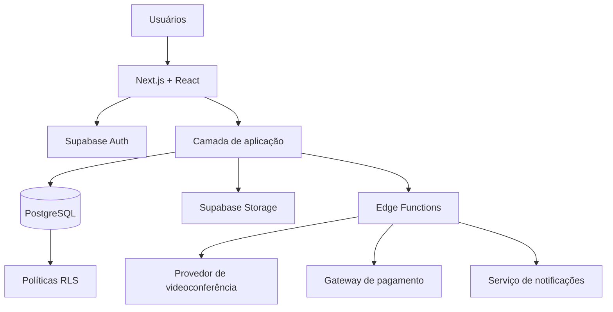

# ARQUITETURA DO SISTEMA
## Sistema Acadêmico do Curso de Crescimento Cristão — CCC

**Documento:** Arquitetura de Software  
**Versão:** 1.0  
**Status:** Arquitetura proposta  
**Última atualização:** Novembro de 2026

---

## 1. Visão arquitetural

O Sistema Acadêmico CCC será desenvolvido com uma arquitetura web moderna, organizada por módulos e preparada para expansão.

A solução proposta utiliza Next.js, React e TypeScript no frontend, com Supabase como plataforma de backend, autenticação, banco de dados e armazenamento.

A arquitetura deverá separar as responsabilidades de interface, regras de negócio, persistência de dados e integrações externas.

## 2. Tecnologias propostas

### 2.1 Frontend

| Tecnologia | Responsabilidade |
|---|---|
| Next.js | Framework principal da aplicação. |
| React | Construção de interfaces por componentes. |
| TypeScript | Tipagem estática e maior segurança no desenvolvimento. |
| HTML5 | Estrutura semântica das páginas. |
| CSS3 | Estilização das interfaces. |
| Tailwind CSS | Sistema de estilos utilitários. |
| JavaScript | Linguagem base do ecossistema React/Next.js. |

**Observação:** HTML, CSS e JavaScript continuam fazendo parte do projeto. O Next.js utiliza React para organizar a interface e permite trabalhar com componentes em arquivos TSX e JSX.

### 2.2 Backend e dados

| Tecnologia | Responsabilidade |
|---|---|
| Supabase | Plataforma de backend e serviços gerenciados. |
| Supabase Auth | Cadastro, login e gerenciamento de identidade. |
| PostgreSQL | Banco de dados relacional. |
| Supabase Storage | Armazenamento de arquivos e materiais. |
| Supabase Edge Functions | Execução de operações de backend e integrações. |
| Row Level Security (RLS) | Controle de acesso aos dados no banco. |

### 2.3 Ferramentas de desenvolvimento

- Visual Studio Code;
- Git;
- GitHub;
- npm;
- Navegadores modernos.

### 2.4 PWA

A aplicação deverá ser preparada como Progressive Web App (PWA), permitindo instalação em dispositivos compatíveis.

A experiência deverá priorizar dispositivos móveis, mantendo compatibilidade com tablets e computadores.

## 3. Arquitetura em camadas

A solução será organizada conceitualmente nas seguintes camadas:

### 3.1 Camada de apresentação

Responsável por:
- Exibir páginas e componentes.
- Apresentar dashboards.
- Exibir formulários.
- Realizar validações de interface.
- Adaptar a navegação ao perfil do usuário.
- Apresentar o progresso acadêmico.

### 3.2 Camada de aplicação

Responsável por:
- Coordenar operações do sistema.
- Aplicar fluxos de cadastro e aprovação.
- Gerenciar matrículas.
- Controlar liberação de aulas.
- Solicitar cálculos de frequência.
- Verificar condições de conclusão.
- Coordenar emissão de certificados.

### 3.3 Camada de regras de negócio

Responsável por garantir:
- Aprovação de acesso.
- Pré-requisito do CCC2.
- Aprovação de matrícula.
- Liberação sequencial de aulas.
- Cálculo de frequência.
- Critérios de conclusão.
- Emissão única de certificados.
- Permissões e restrições acadêmicas.

### 3.4 Camada de persistência

Responsável por armazenar:
- Usuários e perfis.
- Cursos e turmas.
- Disciplinas e aulas.
- Matrículas.
- Frequência.
- Progresso.
- Pagamentos.
- Certificados.
- Comunicados e notificações.

### 3.5 Camada de integração

Responsável pela comunicação com serviços externos:
- Provedor de videoconferência.
- Serviço de armazenamento e reprodução de gravações, quando externo.
- Gateway de pagamento.
- Serviço de envio de e-mails ou notificações.

Os provedores ainda não foram definidos.

## 4. Diagrama conceitual



## 5. Módulos da aplicação

### 5.1 Autenticação e autorização
- Cadastro;
- Login;
- Recuperação de senha;
- Solicitação de acesso;
- Aprovação administrativa;
- Controle de permissões.

### 5.2 Gestão acadêmica
- Cursos;
- Turmas;
- Disciplinas;
- Professores;
- Matrículas;
- Histórico acadêmico.

### 5.3 Gestão de aulas
- Cadastro de aulas;
- Organização sequencial;
- Agendamento de encontros ao vivo;
- Gravações;
- Materiais complementares;
- Controle de progresso.

### 5.4 Frequência
- Recebimento de eventos do provedor;
- Validação de eventos;
- Consolidação de presença;
- Cálculo de frequência;
- Justificativas.

### 5.5 Financeiro
- Configuração de cursos gratuitos ou pagos;
- Cobranças;
- Pagamentos;
- Histórico financeiro;
- Relatórios.

### 5.6 Certificação
- Verificação de requisitos;
- Registro de conclusão;
- Emissão de certificados;
- Consulta e validação.

### 5.7 Comunicação
- Comunicados;
- Notificações;
- Avisos acadêmicos.

## 6. Autenticação e autorização

A autenticação será realizada pelo Supabase Auth.

A tabela `profiles` deverá armazenar informações complementares do usuário, vinculadas ao identificador da conta de autenticação.

As permissões serão organizadas por papéis, utilizando uma estrutura de roles e user_roles.

A autorização deverá ser aplicada em diferentes níveis:
- Interface: exibição de funcionalidades conforme o perfil;
- Servidor: validação das operações solicitadas;
- Banco de dados: políticas RLS para proteção dos registros.

Ocultar um botão na interface não será considerado mecanismo suficiente de segurança.

## 7. Integrações externas

### 7.1 Videoconferência

A integração deverá permitir:
- Criar ou armazenar referências de sessões ao vivo;
- Disponibilizar links de participação;
- Receber eventos de entrada e saída;
- Identificar participantes;
- Obter informações necessárias para calcular frequência;
- Associar gravações às aulas.

A integração deverá validar a autenticidade dos eventos recebidos.

### 7.2 Pagamentos

Quando houver cursos pagos, o sistema poderá integrar um gateway para:
- Criar cobranças;
- Consultar transações;
- Receber notificações de pagamento;
- Atualizar o status financeiro.

A confirmação deverá ocorrer por comunicação validada no servidor.

### 7.3 Armazenamento de gravações

As gravações poderão ser armazenadas no Supabase Storage ou em serviço externo compatível.

O acesso deverá ser controlado, evitando links públicos permanentes para conteúdos privados.

## 8. Estrutura de diretórios proposta

A estrutura abaixo é uma referência de organização. Poderá ser ajustada durante a implementação.

```text
sistema-academico-ccc/
│
├── public/
│   ├── icons/
│   ├── images/
│   └── manifest.json
│
├── src/
│   ├── app/
│   │   ├── (public)/
│   │   ├── (auth)/
│   │   ├── (dashboard)/
│   │   ├── admin/
│   │   ├── coordenacao/
│   │   ├── professor/
│   │   ├── aluno/
│   │   ├── layout.tsx
│   │   └── page.tsx
│   │
│   ├── components/
│   │   ├── ui/
│   │   ├── layout/
│   │   ├── forms/
│   │   └── dashboard/
│   │
│   ├── features/
│   │   ├── auth/
│   │   ├── users/
│   │   ├── courses/
│   │   ├── classes/
│   │   ├── subjects/
│   │   ├── lessons/
│   │   ├── attendance/
│   │   ├── payments/
│   │   ├── certificates/
│   │   └── notifications/
│   │
│   ├── lib/
│   │   ├── supabase/
│   │   ├── validations/
│   │   └── utils/
│   │
│   ├── services/
│   ├── types/
│   └── hooks/
│
├── supabase/
│   ├── migrations/
│   ├── functions/
│   └── seed.sql
│
├── docs/
│
├── .env.example
├── .gitignore
├── next.config.ts
├── package.json
├── tsconfig.json
├── README.md
├── DOCUMENTACAO.md
├── REQUISITOS.md
├── REGRAS_DE_NEGOCIO.md
├── ARQUITETURA.md
└── BANCO_DE_DADOS.md
```

## 9. Segurança

A arquitetura deverá contemplar:

- Autenticação gerenciada pelo Supabase Auth;
- Políticas RLS nas tabelas protegidas;
- Validação de permissões no servidor;
- Proteção de rotas;
- Validação de dados recebidos;
- Proteção de arquivos privados;
- Registro de operações administrativas;
- Uso de variáveis de ambiente;
- Proteção de segredos e credenciais;
- Conformidade com a LGPD.

A chave `service_role` do Supabase nunca deverá ser disponibilizada no frontend.

## 10. Estratégia de implementação

A implementação deverá ocorrer gradualmente:

1. Configuração do projeto e ambiente.
2. Estrutura visual e componentes.
3. Integração com Supabase.
4. Autenticação e perfis.
5. Solicitações e aprovação de acesso.
6. Cursos, turmas e matrículas.
7. Disciplinas, aulas e materiais.
8. Liberação sequencial.
9. Integração de videoconferência e frequência.
10. Financeiro.
11. Conclusão e certificados.
12. Testes, segurança e publicação.

## 11. Decisões arquiteturais pendentes

- Provedor de videoconferência;
- Serviço definitivo para gravações;
- Gateway de pagamento;
- Serviço de envio de e-mails;
- Estratégia de hospedagem;
- Política de backup;
- Estratégia de monitoramento e logs;
- Definição final da identidade visual.
