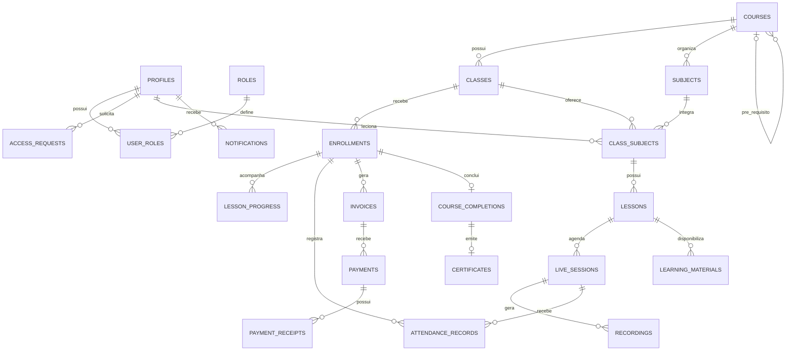

# BANCO DE DADOS
## Sistema Acadêmico do Curso de Crescimento Cristão — CCC

**Documento:** Modelagem e Estrutura do Banco de Dados  
**Versão:** 1.0  
**Status:** Modelo lógico proposto  
**Banco de dados:** PostgreSQL  
**Plataforma prevista:** Supabase  
**Última atualização:** Novembro de 2026

---

## 1. Objetivo

Este documento apresenta a modelagem inicial do banco de dados do Sistema Acadêmico CCC.

O banco será responsável por armazenar e relacionar as informações dos usuários, cursos, turmas, matrículas, disciplinas, aulas, frequência, pagamentos, certificados e demais funcionalidades da plataforma.

A modelagem proposta utiliza PostgreSQL, disponibilizado por meio do Supabase.

**Importante:** este documento representa o modelo lógico inicial. A implementação definitiva exigirá migrations SQL, constraints, índices, políticas RLS, funções, triggers e testes.

## 2. Tecnologia

| Tecnologia | Finalidade |
|---|---|
| PostgreSQL | Banco de dados relacional. |
| Supabase | Plataforma de gerenciamento do backend. |
| Supabase Auth | Gerenciamento de identidade e autenticação. |
| Supabase Storage | Armazenamento de arquivos. |
| Row Level Security | Segurança e controle de acesso aos registros. |

## 3. Organização dos dados

O banco será dividido conceitualmente em módulos:

1. Identidade e acesso;
2. Gestão acadêmica;
3. Conteúdos e aulas;
4. Frequência e participação;
5. Financeiro;
6. Conclusão e certificação;
7. Comunicação e notificações;
8. Auditoria.

## 4. Modelo de entidades

### 4.1 Identidade e acesso

#### Tabela: `profiles`

Armazena os dados complementares dos usuários cadastrados.

| Campo | Tipo sugerido | Descrição |
|---|---|---|
| id | UUID | Chave primária e referência a `auth.users.id`. |
| full_name | VARCHAR(150) | Nome completo. |
| email | VARCHAR(255) | E-mail de contato, conforme estratégia de sincronização definida. |
| phone | VARCHAR(30) | Telefone. |
| avatar_url | TEXT | Referência à imagem de perfil. |
| created_at | TIMESTAMPTZ | Data de criação. |
| updated_at | TIMESTAMPTZ | Data de atualização. |

**Regra:** a tabela não deverá armazenar senhas. A autenticação e as credenciais serão gerenciadas pelo Supabase Auth.

#### Tabela: `roles`

Armazena os papéis disponíveis no sistema.

| Campo | Tipo sugerido | Descrição |
|---|---|---|
| id | UUID | Chave primária. |
| name | VARCHAR(50) | Nome do perfil. |
| description | TEXT | Descrição do papel. |
| created_at | TIMESTAMPTZ | Data de criação. |

Papéis previstos:
- admin;
- coordinator;
- teacher;
- student.

#### Tabela: `user_roles`

Relaciona usuários aos seus papéis.

| Campo | Tipo sugerido | Descrição |
|---|---|---|
| id | UUID | Chave primária. |
| user_id | UUID | Referência a `profiles.id`. |
| role_id | UUID | Referência a `roles.id`. |
| created_at | TIMESTAMPTZ | Data de associação. |

**Regra:** a combinação `user_id` e `role_id` deverá ser única para evitar atribuições duplicadas.

#### Tabela: `access_requests`

Registra solicitações de acesso à plataforma.

| Campo | Tipo sugerido | Descrição |
|---|---|---|
| id | UUID | Chave primária. |
| user_id | UUID | Referência ao usuário. |
| status | VARCHAR(20) | pending, approved ou rejected. |
| reviewed_by | UUID | Administrador responsável pela análise. |
| reviewed_at | TIMESTAMPTZ | Data da análise. |
| rejection_reason | TEXT | Motivo da rejeição, quando informado. |
| created_at | TIMESTAMPTZ | Data da solicitação. |
| updated_at | TIMESTAMPTZ | Data da atualização. |

#### Tabela: `audit_logs`

Registra operações relevantes realizadas no sistema.

| Campo | Tipo sugerido | Descrição |
|---|---|---|
| id | UUID | Chave primária. |
| user_id | UUID | Usuário responsável, quando identificado. |
| action | VARCHAR(100) | Ação executada. |
| entity | VARCHAR(100) | Entidade afetada. |
| entity_id | UUID | Identificador do registro afetado. |
| metadata | JSONB | Informações adicionais não sensíveis. |
| created_at | TIMESTAMPTZ | Data da operação. |

Os registros de auditoria deverão ser protegidos contra alterações indevidas.

---

### 4.2 Gestão acadêmica

#### Tabela: `courses`

Armazena os cursos disponíveis.

| Campo | Tipo sugerido | Descrição |
|---|---|---|
| id | UUID | Chave primária. |
| name | VARCHAR(150) | Nome do curso. |
| slug | VARCHAR(150) | Identificador amigável. |
| description | TEXT | Descrição. |
| status | VARCHAR(30) | Situação do curso. |
| prerequisite_course_id | UUID | Curso obrigatório anterior, quando existir. |
| is_paid | BOOLEAN | Indica se o curso é pago. |
| price | NUMERIC(10,2) | Valor do curso, quando aplicável. |
| min_attendance_percentage | NUMERIC(5,2) | Frequência mínima exigida. |
| recording_completion_percentage | NUMERIC(5,2) | Percentual de visualização para concluir gravações. |
| created_at | TIMESTAMPTZ | Data de criação. |
| updated_at | TIMESTAMPTZ | Data de atualização. |

Cursos iniciais:
- CCC1;
- CCC2.

**Regra:** `prerequisite_course_id` poderá apontar para o CCC1 quando o curso for CCC2.

A validação de pré-requisitos deverá ocorrer no servidor, não apenas na interface.

#### Tabela: `classes`

Representa as turmas dos cursos.

| Campo | Tipo sugerido | Descrição |
|---|---|---|
| id | UUID | Chave primária. |
| course_id | UUID | Referência a `courses.id`. |
| name | VARCHAR(150) | Nome da turma. |
| start_date | DATE | Data de início. |
| end_date | DATE | Data de encerramento. |
| status | VARCHAR(30) | Situação da turma. |
| created_at | TIMESTAMPTZ | Data de criação. |
| updated_at | TIMESTAMPTZ | Data de atualização. |

**Regra da primeira versão:** deverá existir somente uma turma por curso.

Para isso, a coluna `course_id` deverá possuir uma restrição `UNIQUE`.

Essa restrição poderá ser revista quando o sistema passar a suportar várias turmas por curso.

#### Tabela: `enrollments`

Registra as matrículas dos alunos.

| Campo | Tipo sugerido | Descrição |
|---|---|---|
| id | UUID | Chave primária. |
| student_id | UUID | Referência a `profiles.id`. |
| class_id | UUID | Referência a `classes.id`. |
| status | VARCHAR(30) | Situação da matrícula. |
| requested_at | TIMESTAMPTZ | Data da solicitação. |
| approved_by | UUID | Responsável pela aprovação. |
| approved_at | TIMESTAMPTZ | Data da aprovação. |
| enrolled_at | TIMESTAMPTZ | Data efetiva da matrícula. |
| completed_at | TIMESTAMPTZ | Data da conclusão. |
| created_at | TIMESTAMPTZ | Data de criação. |

Possíveis estados:
- pending;
- approved;
- rejected;
- active;
- completed;
- cancelled.

Os estados deverão ser validados por constraints ou enumerações controladas.

A matrícula deverá possuir restrições que impeçam registros duplicados indevidos para o mesmo aluno e turma.

#### Tabela: `subjects`

Armazena as disciplinas pertencentes aos cursos.

| Campo | Tipo sugerido | Descrição |
|---|---|---|
| id | UUID | Chave primária. |
| course_id | UUID | Referência a `courses.id`. |
| name | VARCHAR(150) | Nome da disciplina. |
| description | TEXT | Descrição. |
| sequence_order | INTEGER | Ordem da disciplina no curso. |
| status | VARCHAR(30) | Situação. |
| created_at | TIMESTAMPTZ | Data de criação. |

#### Tabela: `class_subjects`

Relaciona disciplinas às turmas e define o professor responsável.

| Campo | Tipo sugerido | Descrição |
|---|---|---|
| id | UUID | Chave primária. |
| class_id | UUID | Referência a `classes.id`. |
| subject_id | UUID | Referência a `subjects.id`. |
| teacher_id | UUID | Referência a `profiles.id`. |
| sequence_order | INTEGER | Ordem na turma. |
| created_at | TIMESTAMPTZ | Data de criação. |

Essa tabela permite que uma disciplina de um curso seja oferecida em uma turma específica e tenha um professor responsável.

Deverá existir validação para impedir que uma disciplina seja vinculada a uma turma de outro curso.

---

### 4.3 Conteúdos e aulas

#### Tabela: `lessons`

Armazena as aulas de cada disciplina oferecida na turma.

| Campo | Tipo sugerido | Descrição |
|---|---|---|
| id | UUID | Chave primária. |
| class_subject_id | UUID | Referência a `class_subjects.id`. |
| title | VARCHAR(200) | Título da aula. |
| description | TEXT | Descrição. |
| sequence_order | INTEGER | Ordem da aula. |
| content_type | VARCHAR(30) | Tipo de conteúdo. |
| video_url | TEXT | Referência ao vídeo ou gravação. |
| duration_seconds | INTEGER | Duração do vídeo em segundos. |
| is_required | BOOLEAN | Indica se a aula é obrigatória. |
| release_at | TIMESTAMPTZ | Data de liberação programada, quando aplicável. |
| status | VARCHAR(30) | Situação da aula. |
| created_at | TIMESTAMPTZ | Data de criação. |
| updated_at | TIMESTAMPTZ | Data de atualização. |

#### Tabela: `live_sessions`

Armazena os encontros ao vivo.

| Campo | Tipo sugerido | Descrição |
|---|---|---|
| id | UUID | Chave primária. |
| lesson_id | UUID | Referência a `lessons.id`. |
| provider | VARCHAR(50) | Provedor de videoconferência. |
| provider_session_id | VARCHAR(255) | Identificador externo da sessão. |
| meeting_url | TEXT | Link de participação. |
| scheduled_start | TIMESTAMPTZ | Data e hora de início. |
| scheduled_end | TIMESTAMPTZ | Data e hora de término. |
| status | VARCHAR(30) | Situação da sessão. |
| created_at | TIMESTAMPTZ | Data de criação. |

#### Tabela: `recordings`

Armazena as referências às gravações das aulas.

| Campo | Tipo sugerido | Descrição |
|---|---|---|
| id | UUID | Chave primária. |
| live_session_id | UUID | Referência à sessão ao vivo. |
| storage_path | TEXT | Caminho do arquivo armazenado. |
| external_url | TEXT | URL externa, quando aplicável. |
| duration_seconds | INTEGER | Duração da gravação. |
| status | VARCHAR(30) | Situação da gravação. |
| available_at | TIMESTAMPTZ | Data de disponibilização. |
| created_at | TIMESTAMPTZ | Data de criação. |

A gravação deverá possuir acesso controlado. Não deverá ser disponibilizada publicamente sem autorização.

#### Tabela: `learning_materials`

Armazena materiais complementares.

| Campo | Tipo sugerido | Descrição |
|---|---|---|
| id | UUID | Chave primária. |
| lesson_id | UUID | Referência a `lessons.id`. |
| title | VARCHAR(200) | Nome do material. |
| file_path | TEXT | Caminho do arquivo. |
| external_url | TEXT | Link externo, quando aplicável. |
| material_type | VARCHAR(50) | Tipo de material. |
| created_at | TIMESTAMPTZ | Data de criação. |

#### Tabela: `lesson_progress`

Registra o progresso individual do aluno nas aulas.

| Campo | Tipo sugerido | Descrição |
|---|---|---|
| id | UUID | Chave primária. |
| enrollment_id | UUID | Referência a `enrollments.id`. |
| lesson_id | UUID | Referência a `lessons.id`. |
| watched_seconds | INTEGER | Tempo assistido acumulado. |
| completion_percentage | NUMERIC(5,2) | Percentual de conclusão. |
| is_completed | BOOLEAN | Indica conclusão. |
| completed_at | TIMESTAMPTZ | Data da conclusão. |
| updated_at | TIMESTAMPTZ | Data de atualização. |

Deverá existir uma restrição única para a combinação `enrollment_id` e `lesson_id`.

O progresso deverá ser validado no servidor. O sistema deverá evitar que o aluno envie diretamente um percentual arbitrário para marcar uma aula como concluída.

---

### 4.4 Frequência e participação

#### Tabela: `attendance_records`

Armazena a frequência consolidada dos alunos nas sessões ao vivo.

| Campo | Tipo sugerido | Descrição |
|---|---|---|
| id | UUID | Chave primária. |
| enrollment_id | UUID | Referência à matrícula. |
| live_session_id | UUID | Referência à sessão ao vivo. |
| first_joined_at | TIMESTAMPTZ | Primeiro horário de entrada. |
| last_left_at | TIMESTAMPTZ | Último horário de saída. |
| attended_seconds | INTEGER | Tempo total de participação. |
| attendance_percentage | NUMERIC(5,2) | Percentual de presença. |
| status | VARCHAR(30) | Situação da frequência. |
| calculated_at | TIMESTAMPTZ | Data do cálculo. |
| created_at | TIMESTAMPTZ | Data de criação. |

A combinação `enrollment_id` e `live_session_id` deverá ser única.

#### Tabela: `attendance_policies`

Armazena as configurações de frequência.

| Campo | Tipo sugerido | Descrição |
|---|---|---|
| id | UUID | Chave primária. |
| course_id | UUID | Referência ao curso. |
| minimum_percentage | NUMERIC(5,2) | Percentual mínimo exigido. |
| justification_enabled | BOOLEAN | Permite justificativas. |
| created_at | TIMESTAMPTZ | Data de criação. |
| updated_at | TIMESTAMPTZ | Data de atualização. |

As regras deverão permitir configuração por curso.

#### Tabela: `attendance_justifications`

Armazena justificativas de ausência.

| Campo | Tipo sugerido | Descrição |
|---|---|---|
| id | UUID | Chave primária. |
| attendance_record_id | UUID | Referência à frequência. |
| student_id | UUID | Usuário solicitante. |
| reason | TEXT | Motivo informado. |
| attachment_path | TEXT | Arquivo comprobatório, quando aplicável. |
| status | VARCHAR(30) | pending, approved ou rejected. |
| reviewed_by | UUID | Responsável pela análise. |
| reviewed_at | TIMESTAMPTZ | Data da análise. |
| created_at | TIMESTAMPTZ | Data da solicitação. |

#### Tabela: `participation_events`

Armazena eventos recebidos do provedor de videoconferência.

| Campo | Tipo sugerido | Descrição |
|---|---|---|
| id | UUID | Chave primária. |
| provider | VARCHAR(50) | Nome do provedor. |
| provider_event_id | VARCHAR(255) | Identificador único do evento externo. |
| provider_session_id | VARCHAR(255) | Identificador da sessão externa. |
| user_id | UUID | Usuário identificado, quando possível. |
| event_type | VARCHAR(50) | Tipo do evento, como entrada ou saída. |
| occurred_at | TIMESTAMPTZ | Data e hora do evento. |
| payload | JSONB | Dados necessários para processamento, sem informações desnecessárias. |
| processed_at | TIMESTAMPTZ | Data do processamento. |
| created_at | TIMESTAMPTZ | Data de recebimento. |

O campo `provider_event_id` deverá possuir uma restrição de unicidade por provedor, evitando o processamento duplicado de eventos.

Os eventos deverão ser validados no servidor antes de gerar ou atualizar registros de frequência.

---

### 4.5 Financeiro

#### Tabela: `payment_plans`

Armazena configurações de cobrança.

| Campo | Tipo sugerido | Descrição |
|---|---|---|
| id | UUID | Chave primária. |
| course_id | UUID | Referência ao curso. |
| name | VARCHAR(150) | Nome do plano. |
| amount | NUMERIC(10,2) | Valor. |
| installments | INTEGER | Quantidade de parcelas, quando aplicável. |
| is_active | BOOLEAN | Indica disponibilidade. |
| created_at | TIMESTAMPTZ | Data de criação. |

#### Tabela: `invoices`

Armazena cobranças vinculadas às matrículas.

| Campo | Tipo sugerido | Descrição |
|---|---|---|
| id | UUID | Chave primária. |
| enrollment_id | UUID | Referência à matrícula. |
| payment_plan_id | UUID | Referência ao plano. |
| amount | NUMERIC(10,2) | Valor cobrado. |
| due_date | DATE | Data de vencimento. |
| status | VARCHAR(30) | Situação da cobrança. |
| created_at | TIMESTAMPTZ | Data de criação. |

#### Tabela: `payments`

Armazena transações financeiras.

| Campo | Tipo sugerido | Descrição |
|---|---|---|
| id | UUID | Chave primária. |
| invoice_id | UUID | Referência à cobrança. |
| provider | VARCHAR(50) | Gateway utilizado. |
| provider_transaction_id | VARCHAR(255) | Identificador externo. |
| amount | NUMERIC(10,2) | Valor pago. |
| payment_method | VARCHAR(50) | Forma de pagamento. |
| status | VARCHAR(30) | Situação da transação. |
| paid_at | TIMESTAMPTZ | Data da confirmação. |
| created_at | TIMESTAMPTZ | Data de criação. |

#### Tabela: `payment_receipts`

Armazena comprovantes de pagamento.

| Campo | Tipo sugerido | Descrição |
|---|---|---|
| id | UUID | Chave primária. |
| payment_id | UUID | Referência ao pagamento. |
| file_path | TEXT | Caminho do comprovante. |
| uploaded_at | TIMESTAMPTZ | Data de envio. |

As informações financeiras deverão ser acessíveis somente aos perfis autorizados.

---

### 4.6 Conclusão e certificação

#### Tabela: `course_completions`

Registra a conclusão acadêmica dos alunos.

| Campo | Tipo sugerido | Descrição |
|---|---|---|
| id | UUID | Chave primária. |
| enrollment_id | UUID | Referência à matrícula. |
| completed_at | TIMESTAMPTZ | Data da conclusão. |
| attendance_met | BOOLEAN | Indica cumprimento da frequência. |
| lessons_met | BOOLEAN | Indica conclusão das aulas obrigatórias. |
| requirements_snapshot | JSONB | Registro dos critérios verificados. |
| created_at | TIMESTAMPTZ | Data de criação. |

Deverá existir uma restrição de unicidade para evitar múltiplos registros de conclusão para a mesma matrícula.

#### Tabela: `certificates`

Armazena certificados emitidos.

| Campo | Tipo sugerido | Descrição |
|---|---|---|
| id | UUID | Chave primária. |
| course_completion_id | UUID | Referência à conclusão. |
| student_id | UUID | Referência ao aluno. |
| certificate_number | VARCHAR(100) | Número de identificação. |
| file_path | TEXT | Caminho do arquivo. |
| issued_at | TIMESTAMPTZ | Data de emissão. |
| verification_code | UUID | Código de validação. |
| status | VARCHAR(30) | Situação do certificado. |

Cada conclusão deverá possuir, no máximo, um certificado válido, conforme a política de emissão definida.

---

### 4.7 Comunicação

#### Tabela: `announcements`

Armazena comunicados publicados na plataforma.

| Campo | Tipo sugerido | Descrição |
|---|---|---|
| id | UUID | Chave primária. |
| title | VARCHAR(200) | Título. |
| content | TEXT | Conteúdo. |
| author_id | UUID | Usuário responsável. |
| course_id | UUID | Curso relacionado, quando aplicável. |
| class_id | UUID | Turma relacionada, quando aplicável. |
| published_at | TIMESTAMPTZ | Data de publicação. |
| status | VARCHAR(30) | Situação. |
| created_at | TIMESTAMPTZ | Data de criação. |

#### Tabela: `notifications`

Armazena notificações direcionadas aos usuários.

| Campo | Tipo sugerido | Descrição |
|---|---|---|
| id | UUID | Chave primária. |
| user_id | UUID | Usuário destinatário. |
| title | VARCHAR(200) | Título. |
| message | TEXT | Mensagem. |
| notification_type | VARCHAR(50) | Tipo da notificação. |
| read_at | TIMESTAMPTZ | Data da leitura. |
| created_at | TIMESTAMPTZ | Data de criação. |

---

## 5. Relacionamentos principais

| Entidade de origem | Relacionamento | Entidade de destino |
|---|---|---|
| profiles | 1:N | user_roles |
| roles | 1:N | user_roles |
| profiles | 1:N | access_requests |
| courses | 1:N | classes |
| courses | 1:N | subjects |
| courses | 1:N | enrollments, indiretamente por classes |
| courses | 0:N | courses, por pré-requisito |
| classes | 1:N | enrollments |
| classes | 1:N | class_subjects |
| subjects | 1:N | class_subjects |
| profiles | 1:N | class_subjects, como professor |
| class_subjects | 1:N | lessons |
| lessons | 1:N | live_sessions |
| lessons | 1:N | learning_materials |
| live_sessions | 1:N | recordings |
| enrollments | 1:N | lesson_progress |
| enrollments | 1:N | attendance_records |
| live_sessions | 1:N | attendance_records |
| live_sessions | 1:N | participation_events, por identificação externa da sessão |
| enrollments | 1:N | invoices |
| invoices | 1:N | payments |
| payments | 1:N | payment_receipts |
| enrollments | 0:1 | course_completions |
| course_completions | 0:1 | certificates |
| profiles | 1:N | notifications |

## 6. Diagrama ER conceitual



## 7. Regras de integridade

O banco deverá aplicar restrições para proteger a consistência dos dados.

### 7.1 Chaves primárias
As tabelas principais deverão utilizar identificadores UUID como chaves primárias.

### 7.2 Chaves estrangeiras
Os relacionamentos deverão utilizar foreign keys para impedir referências a registros inexistentes.

### 7.3 Restrições de unicidade
Deverão ser consideradas, entre outras:

- `user_roles`: combinação única de usuário e papel;
- `classes`: `course_id` único na versão inicial;
- `enrollments`: combinação de aluno e turma sem duplicidade indevida;
- `class_subjects`: combinação única de turma e disciplina;
- `lesson_progress`: combinação única de matrícula e aula;
- `attendance_records`: combinação única de matrícula e sessão ao vivo;
- `participation_events`: combinação única de provedor e identificador do evento;
- `course_completions`: matrícula única;
- `certificates`: conclusão única e número de certificado único.

### 7.4 Validações numéricas

Percentuais deverão aceitar somente valores entre 0 e 100.

Valores financeiros não deverão aceitar números negativos, salvo se uma operação específica de ajuste financeiro for formalmente definida.

A duração de aulas, gravações e participações deverá ser validada para impedir valores negativos.

## 8. Segurança e RLS

O banco deverá utilizar Row Level Security (RLS) nas tabelas que armazenam informações protegidas.

Políticas previstas:

### Administrador
- Acesso administrativo conforme suas permissões.
- Gerenciamento de usuários, cursos e turmas.
- Consulta de dados acadêmicos e financeiros autorizados.

### Coordenador
- Acesso às informações acadêmicas necessárias à coordenação.
- Consulta de turmas, matrículas e frequência.
- Aprovação de matrículas conforme permissões.

### Professor
- Consulta de suas disciplinas.
- Consulta dos alunos vinculados às suas turmas.
- Acesso às informações de frequência e progresso necessárias à sua atuação.

### Aluno
- Consulta dos próprios dados.
- Consulta das próprias matrículas.
- Consulta do próprio progresso e frequência.
- Acesso aos conteúdos liberados.
- Consulta dos próprios pagamentos e certificados.

**Atenção:** as políticas deverão considerar a relação entre usuário, matrícula, turma e disciplina. Não basta verificar somente se o usuário está autenticado.

## 9. Processamento de operações críticas

Algumas operações não deverão ser executadas diretamente pelo frontend.

Deverão ser processadas por funções seguras no servidor ou mecanismos controlados no banco:

- Aprovação de acesso;
- Aprovação de matrícula;
- Validação de pré-requisitos;
- Liberação sequencial de aulas;
- Processamento de eventos de videoconferência;
- Consolidação de frequência;
- Confirmação de pagamentos;
- Verificação de conclusão;
- Emissão de certificados.

As operações deverão considerar transações, idempotência e validação de permissões.

## 10. Estratégia de migrations

A estrutura do banco deverá ser versionada utilizando migrations SQL.

Estrutura proposta:

```text
supabase/
│
├── migrations/
│   ├── 001_create_profiles.sql
│   ├── 002_create_roles.sql
│   ├── 003_create_access_requests.sql
│   ├── 004_create_courses.sql
│   ├── 005_create_classes.sql
│   ├── 006_create_enrollments.sql
│   ├── 007_create_subjects.sql
│   ├── 008_create_class_subjects.sql
│   ├── 009_create_lessons.sql
│   ├── 010_create_live_sessions.sql
│   ├── 011_create_recordings.sql
│   ├── 012_create_learning_materials.sql
│   ├── 013_create_lesson_progress.sql
│   ├── 014_create_attendance.sql
│   ├── 015_create_financial.sql
│   ├── 016_create_certificates.sql
│   ├── 017_create_notifications.sql
│   └── 018_create_rls_policies.sql
│
└── seed.sql
```

A numeração é ilustrativa. As migrations reais deverão ser criadas conforme a ordem das dependências entre as tabelas.

## 11. Dados iniciais

A configuração inicial deverá contemplar:

### Cursos
- CCC1 — Curso de Crescimento Cristão 1;
- CCC2 — Curso de Crescimento Cristão 2.

### Papéis
- Administrador;
- Coordenador;
- Professor;
- Aluno.

Os dados iniciais deverão ser inseridos de maneira controlada, evitando criação duplicada em diferentes ambientes.

## 12. Índices recomendados

Deverão ser avaliados índices para consultas frequentes, especialmente:

- `profiles.email`;
- `access_requests.status`;
- `enrollments.student_id`;
- `enrollments.class_id`;
- `subjects.course_id`;
- `class_subjects.class_id`;
- `class_subjects.teacher_id`;
- `lessons.class_subject_id`;
- `live_sessions.scheduled_start`;
- `attendance_records.enrollment_id`;
- `participation_events.provider_event_id`;
- `invoices.enrollment_id`;
- `payments.invoice_id`;
- `notifications.user_id`.

Índices deverão ser criados conforme as consultas reais e os planos de execução, evitando índices desnecessários.

## 13. Política de armazenamento

O Supabase Storage poderá ser utilizado para:

- Fotos de perfil;
- Materiais de apoio;
- Gravações;
- Comprovantes;
- Certificados.

Os arquivos privados deverão utilizar buckets privados e políticas de acesso apropriadas.

A aplicação deverá utilizar URLs assinadas ou mecanismos equivalentes para disponibilizar arquivos protegidos.

## 14. LGPD e proteção de dados

O banco deverá seguir princípios de proteção de dados pessoais:

- Coletar apenas informações necessárias;
- Restringir acesso por perfil;
- Proteger arquivos e documentos;
- Evitar exposição de dados sensíveis;
- Registrar operações administrativas relevantes;
- Definir políticas de retenção;
- Permitir atendimento aos direitos dos titulares;
- Proteger credenciais e segredos.

## 15. Pontos pendentes

Antes da implementação definitiva, deverão ser definidos:

- Percentual mínimo de frequência;
- Percentual de visualização para conclusão;
- Regras para faltas justificadas;
- Política de retenção de gravações;
- Gateway de pagamento;
- Política de cancelamento e reembolso;
- Necessidade de parcelamento;
- Dados obrigatórios de emissão de certificados;
- Política de retenção e exclusão de dados.

## 16. Observações técnicas finais

Este modelo é uma proposta inicial para orientar a implementação do banco de dados.

Ele ainda não representa um banco de produção.

Antes da publicação, será necessário:

1. Criar e revisar as migrations.
2. Definir os tipos e constraints definitivos.
3. Implementar as políticas RLS de todas as tabelas protegidas.
4. Criar funções e triggers necessários.
5. Validar as permissões de cada perfil.
6. Implementar transações nas operações críticas.
7. Criar testes de integridade e segurança.
8. Revisar a modelagem com base nas integrações escolhidas.

**Princípio fundamental:** a integridade acadêmica, financeira e dos certificados deverá ser garantida pelo backend e pelo banco de dados, e não somente pela interface da aplicação.
